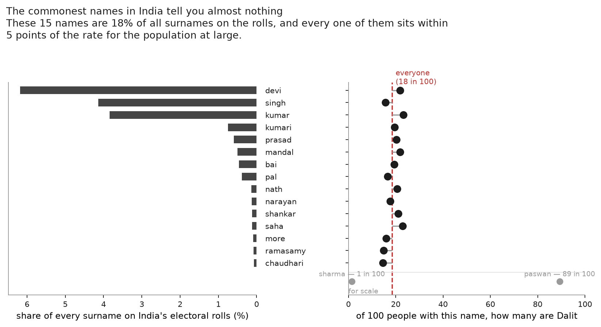
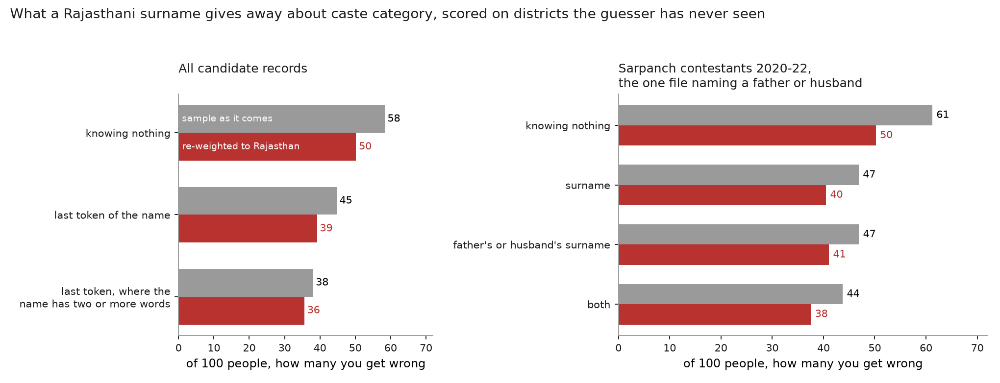

# On a last-name basis

**In a village everyone already knows your caste. In a city a stranger has your
name.**

India is urbanising, and that moves the question of who can identify whom. In a
village, caste is common knowledge: the settlement, the hamlet, whose son you
are, which lane you live on. A city strips most of that away. What survives on a
rental application or a job form is a name.

How much does a last name give away? Anyone acting on caste has to work it out
first, and so does anyone auditing them for it: a study asking whether Dalits
get fewer callbacks usually infers caste from the applicant's name.

This repo measures that inference. It measures what a surname reveals about
caste, whom it reveals least about, and what has to be added to a name before it
reveals a lot.

The operational question: pick an Indian adult at random, know only their last
name, and how often are you wrong about their caste?

**About 20 times in 100.** Knowing nothing at all, you would be wrong 25 times.
The name is worth about five mistakes, and almost all of that comes from a
handful of names hardly anybody carries.

Everything below is measured in that one unit: **of a hundred people, how many
would you get wrong?**

Error rates depend on two things besides the surname. The first is the number of
categories: sorting people into Dalit, Adivasi or neither is easier than placing
them among 141 Bihari jatis, and the same surname leaves 20 mistakes in the
first case and 47 in the second. The second is what else the guesser knows: a
surname with a village is a different predictor from a surname alone.

Given that both vary across the analyses below, each result is reported with its
target and its cues. Error rates computed against different targets are not
comparable.

## The data, and why it takes several kinds

Indian electoral rolls do not record caste, and the caste census does not record
where a household sits relative to its neighbours. Given that no single source
carries both, the analyses below combine several sources.

| what it gives | what it cannot give | source |
|---|---|---|
| caste composition of a surname, nationally | fine categories; who actually carries the name today | SECC 2011 |
| how common a name is, and who a person's father or husband is | any caste at all | electoral rolls, 2017 |
| jati and hamlet for every household | anywhere outside Bihar; the landless | Bihar land records, Mahadalit census |
| recorded caste and village per owner entry | partial coverage; still being scraped | Odisha Record of Rights |
| recorded caste and village, with ownership repeated across plots | partial coverage; repeated owners are not separate people | Rajasthan Bhunaksha land records |
| a third population with its own category labels | a population sample of anything | Karnataka PSC lists |
| the OBC / General line, self-declared, with a father's name | a population sample; anything but Rajasthan | Rajasthan panchayat candidates |

The national picture joins caste composition to surname frequencies. The
name-and-geography question needs land records carrying both fields. Bihar is
the established case; the shared Odisha and Rajasthan pipeline extends that
measurement as their crawls progress. Electoral rolls and recruitment lists
provide separate evidence about which part of a name functions as a surname.

### Joining caste to frequency

Every national number joins two sources on the surname.

[**outkast**](https://github.com/appeler/outkast) supplies the caste side, from
the 2011 Socio-Economic and Caste Census. For each surname it gives the share of
its bearers who are Scheduled Caste, Scheduled Tribe, or neither. It ships only
cells holding at least 100 records, which leaves **3,930 surnames**.

[**instate**](https://github.com/appeler/instate) supplies the frequency side,
from the 2017 electoral rolls: how many people carry each surname.

The split is deliberate. SECC counts heads of household, who are mostly men, so
it badly undercounts women's surnames: Devi appears 2.3M times in SECC and 45M
times on the rolls, where it is the commonest surname in the country. So how
common a name is comes from the rolls, and what it means comes from SECC.

Filling a room with a hundred people means drawing surnames at their roll
frequency and reading each one's caste mix off SECC. **That room is 18 Dalit, 6
Adivasi, 76 neither.**

**Read every national number here against one limit.** Those 3,930 surnames are
**58% of all the names people carry** on the rolls. The other 42% are the rarer
names, cut by the 100-record floor, and rare names are the informative ones. So
the room is built from the commoner half of Indian naming, which is the half
that reveals least. Every figure below is a floor on what a surname gives away,
not a ceiling.

### The rest

[**Upnaam**](https://github.com/in-rolls/upnaam) resolves which token in a name
is the recorded surname, versioned, for Bihar, Rajasthan and Maharashtra
(analysis 05). `jati`, which is **not a public repository**, and
[**land**](https://github.com/in-rolls/land) hold the Bihar land records and the
Mahadalit census, with a jati and a hamlet for each household (analyses 02 and
06). [**pranaam**](https://github.com/appeler/pranaam) holds the Karnataka
Public Service Commission select lists (analysis 08), and
[**ror_odisha_2026**](https://github.com/in-rolls/ror_odisha_2026) the Odisha Record of
Rights (analysis 09). The sibling `ror_rajasthan_2026` checkout supplies Rajasthan
Bhunaksha records (analysis 12). Both land-record analyses require local saved
checkpoints; their aggregate reports are reproducible from preserved snapshots.

Analyses 02 and 06 require a local clone of `jati`; analyses 09 and 12 require
the local crawler data described in the [pipeline guide](docs/land-records.md).

## 1. A surname discriminates well and decides badly

Take one Dalit and one non-Dalit at random and rank the pair by what their
surnames say about caste. **The Dalit ranks higher 81 times in 100.** A surname
carrying no information would give 50, and for Adivasi against everyone else the
figure is 91. So a surname is far from silent about who is more likely to be
Dalit.

Now ask the same data to name a single category for each person. Guess "neither"
for everyone in that room of a hundred and you are wrong **25** times. Let
yourself hear the last name and you are wrong **19**.

Those two facts are both true and the gap between them is the point. Only about
19 people in that room are Dalit, so a surname can raise someone's odds a great
deal and still leave them below an even chance, at which point a rule that names
the most likely category goes on answering "not Dalit". The name moves the odds;
it rarely moves the decision.

This is why accuracy is the wrong measure to lead with. In a population that is
70% one group, a rule naming that group is right 70 times in 100 whatever
surnames reveal. The 25 and the 20 above are mostly a statement about how many
Indians are not Dalit.

The five mistakes the decision saves are not spread evenly either. A surname is
**predictive** when few of its bearers fall outside its largest category, and it
**changes the guess** only when that largest category differs from the
population's. The commonest surnames are often the first without being the
second. Yadav is the
fifth commonest surname in India at 2.6% of the roll, and 99% of its bearers
fall outside the schedules, so it leaves 1 mistake per 100. It nonetheless
changes nothing, because "outside the schedules" is what one would have guessed
without it.

For **91% of people the surname does not change the guess at all**. The
surnames that do change it are concentrated in the tail:

| rank by frequency | names | share of India | how many change your answer |
|---|---|---|---|
| 1–10 | 10 | **32%** | **none** |
| 11–25 | 15 | 13% | 2 |
| 26–50 | 25 | 10% | 8 |
| 1001–3930 | 2,930 | 6% | 625 |

The ten commonest surnames cover a third of the country, and none of them moves
the guess off the base rate. The 2,930 surnames ranked 1001 and below cover 6%
of people, and 625 of them do move it.

[](analyses/01_surname_to_category/note.md)

A further **15% of people** carry a surname whose caste composition is more
evenly divided than the population's. `ram` is 45% Dalit and 47% not. That is
real information, and it does not change the decision: the best guess for
someone named Ram is still "neither", and it is wrong 53 times per 100, the same
rate as guessing without the name. Such a surname warrants less confidence in an
answer it does not alter.

*Analysis: [01](analyses/01_surname_to_category). The ranking statistic is
the Mann-Whitney statistic, equivalently the area under the ROC curve, computed
twice by different routes as a check.*

## 2. "Last name" is not one thing across India

Part of the answer to claim 1 is that the thing being measured is not stable.
The last token of an Indian name is a family name in some places and something
else in others, and three of the analyses here found it failing in three
different ways.

**It can mark sex rather than family.** The commonest last name in India is
**devi**, at 6.2% of the electoral roll. On the Bihar rolls **81% of women carry
a name from this group against 10% of men**, and the family names in the same
state read as 84 to 89% male, because those families' women are on the roll as
Devi. A woman and her brother do not share a last name, and a name assigned by
sex cannot track a lineage. The clear cases cover **10.4% of the country**, and
adding Singh and Kumar takes it to **18%**.

**19** names cover a quarter of India, and **100** if you count only names a
brother and sister share. That gap is not a correction toward a truer figure.
Indian naming is as concentrated as the first number says, and Devi really is
what tens of millions of women are called on a roll. The two count different
things, names and lineages, and the distance between them is the room the caste
signal used to occupy.

[](analyses/03_how_few_names/note.md)

**It can be in the other position.** Every electoral roll record carries the
elector's father or husband, and a token appearing in both names is one that
passed between two family members. That test confirms the ten sex-marking names,
which all transmit under 1% of the time, and splits the two the hand list called
ambiguous: **Singh transmits 78% of the time and Kumar 8%**. It also found that
**Maharashtra writes the surname first**, as in `patil ashwini` with father
`patil ashok`, so instate's last-token column holds a *given* name there.
Analysis 03's Maharashtra and Gujarat figures were withdrawn.

**It can be an initial.** In Karnataka's Public Service Commission select lists
the last token is a single letter **34% of the time**, and the six commonest are
`S`, `R`, `K`, `N`, `B`, `C`. Drop single letters and the list becomes `Kumar`,
`Patil`, `Naik`, `Manjunatha`: two inventories of "Karnataka's commonest
surnames" from one set of 48,395 names.

[](analyses/08_karnataka_psc/note.md)

**And it can be an initial with nothing behind it.** Kerala is the limiting
case. **78% of last tokens there are a single letter** and only 27% of people
have a written surname at all: a name is a given name followed by initials
standing for a father and a house, as in `KALPANA A` or `SHYLAJA E T`. Scoring
Kerala PSC candidates on Scheduled Caste against the other caste categories, the
last token ranks a Dalit's higher **59 times in 100**, a written surname 70, and
the **given name 69, which everybody has**. The informative part of a Kerala name
is the part no surname-based method reads.

[](analyses/10_kerala_psc/note.md)

Any pipeline that takes the last token and calls it a surname is therefore
measuring something different in each of those places, and in Kerala measuring
almost nothing.

*Analyses: [03](analyses/03_how_few_names),
[04](analyses/04_which_token_is_the_surname),
[08](analyses/08_karnataka_psc),
[10](analyses/10_kerala_psc).*

## 3. The place carries what the name does not

The national figure averages over people whose location is unknown, so it cannot
separate the surname from the place. Bihar's land records identify both. A
surname **and a village** leave **17 mistakes per 100** across 141 jatis; the
surname alone leaves **47**.

Both figures are leave-one-out: when a household is scored, its own record is
excluded from the table used to score it. That matters here because half the
name-and-village cells contain only one household. If its own record is left in,
such a household is matched against itself, and the surname-and-village figure
comes out at 16 instead of 17. The correction is small, but it applies almost
entirely to the surname-and-village rung, which is the rung this comparison
depends on.

[](analyses/02_jati_by_geography/note.md)

**That comparison knows the village in advance**, which is the position of
someone who already knows the place and not of a stranger. Holding whole
villages out of the fitting leaves only the surnames of the *other* households
there as a cue. On the Bihar land records those neighbours save about four
mistakes per 100. The average hides the case: **Chaudhary goes from 80 mistakes
to 56, Prasad from 72 to 54**, while Paswan, which already identifies you at 6,
gains nothing. **The names that carry no caste information alone are the ones
the neighbourhood rescues.**

[](analyses/06_neighbours/note.md)

**How much the place is worth varies enormously by state.** Sorting people into
Dalit, Adivasi or neither, the same guess closes **67% of the gap in Assam and
0% in Haryana**. That measure carries claim 1's problem, so it comes with the
ranking measure beside it, and the two disagree in a way worth seeing. Kerala
closes under 1% of the gap while its surnames separate Dalit from non-Dalit
about as well as Maharashtra's, 0.85 against 0.86, because only 8% of Kerala's
extract is Scheduled Caste. Punjab and Haryana are the states whose surnames
genuinely carry little, at 0.55 and 0.59 against a floor of 0.50.

Punjab's roll says why, and the reason is not simply that its names are
concentrated. Bihar's three commonest names touch 78% of its pairs and Bihar
ranks 0.96. What matters is whether the dominant names sit where the state sits.

The clearest form of it is one surname doing opposite work in two states. In
Bihar, `singh` is carried by 9% of people and almost none of them are Dalit,
against a state that is 18% Dalit; knowing someone is called Singh there tells
you a great deal. In Punjab it is carried by **73%** and its Dalit share is
**0.38 against a state of 0.38**; there it tells you what you already knew.
Across ten states, the more of a state a name covers the closer its composition
sits to that state's own.

**A name that spreads to everyone stops distinguishing anyone.** That is a
process, not a measurement problem. Singh and Kaur were adopted across castes,
and the caste information the surname carried went with the adoption. It is the
same mechanism as claim 2's sex-marking names, seen from the other end: Devi
spread to women of every caste, and stopped meaning anything about lineage for
the same reason. What carries a state is one or two large, decisive names rather
than many of them: Assam has two majority-Dalit surnames among its commonest and
closes two thirds of the gap, because one of them is `das`. Punjab has five and
closes 3%, because its biggest are `ram` at 62% and `lal` at 52%. Haryana has
none at all. Every state's coverage is printed beside its result, because these
are surnames that cleared a 100-record disclosure floor and they cover between
3% and 19% of a state.

[](analyses/07_where_the_name_works/note.md)

[](analyses/07_where_the_name_works/note.md)

**Village information helps in all three states, but Rajasthan is sensitive to
how repeated owner identities are handled.** The September 12, 2026 saved-data
snapshot gives the following errors per 100 observations when predicting the
recorded caste label:

| State | Surname proxy alone | Surname proxy + village | Error reduction (points) |
|---|---:|---:|---:|
| [Bihar](analyses/02_jati_by_geography/note.md) | 47.3 | 17.2 | **30.0** |
| [Odisha](analyses/09_odisha_village_premium/note.md) | 50.6 | 25.6 | **25.0** |
| [Rajasthan](analyses/12_rajasthan_land_village_premium/note.md) | 60.9 | 40.6 | **20.3** |

Errors and reductions are rounded independently. Bihar uses its existing
leave-one-out estimates, with different labels and filtering, including different
record sets for each cue. Odisha and Rajasthan hold out entire accounts and use
the same eligible entries for both cues within each state. These differences
prevent a fair ranking of states.

**Odisha is the clearest new finding:** adding village information roughly halves
errors across 12.16 million eligible owner entries. The reduction stays around
**25–27 points** in the completed-village, matching-signature and exploratory
label-normalization checks. The primary estimate retains the recorded caste
labels, without normalization merges or a rare-label floor.

**Rajasthan needs more caution.** Its primary reduction of 20.3 points across
3.62 million eligible owner entries falls to **9.6 points** under matching-signature
consolidation. That changes membership, weights and training support, as well as
the holdout unit; it does not establish a person-level lower bound. Also,
**84.5% of eligible Rajasthan owner entries have no spaces in the recorded name
field**. A [full source-to-analysis investigation](docs/rajasthan-name-audit.md)
traced this to the portal's recorded spellings, including joined names such as
`रामलाल`, rather than first-word extraction. For those entries, the final-token
proxy is the entire recorded name. The Rajasthan result therefore measures
**name-token plus village information**; it does not establish a family-surname
effect.

On the same Rajasthan entries, using the **whole recorded name** gives a
**19.6-point** village premium; using the whole name **with spaces removed** gives
**19.7 points**. The shared pipeline now reports both comparisons on every
refresh. Space removal gives `रामलाल` and `राम लाल` the same prediction key
while retaining their original spellings and separate owner entries.

Both new analyses use one shared census preparation and scoring pipeline.
Repeated account lists across plots are consolidated while co-owner multiplicity
is retained. The observations are recorded owner entries, not verified unique
people. These are censuses of saved data from unfinished, geographically selective
crawls; the completion and matching-signature checks do not make them
representative of either state's population.

Run `make land-premium` to refresh both states from the sibling crawler checkouts.
The linked analysis notes contain the latest generated results and exclusions;
the table above records the September 12 snapshot. The
[pipeline guide](docs/land-records.md) explains script ownership and replay, and
the [validation report](docs/land-records-validation.md) documents the full census
checks and Rajasthan sensitivity.

## 4. The failure is not spread evenly, and the direction is the worst one

An average error rate conceals who bears it. If the uninformative names are not
spread evenly, every name-based caste method has differential error in a knowable
direction.

They are not. Nationally, the guess is wrong about **66 of every 100 Dalits** and
**4 of every 100 people outside the schedules**, a seventeen-fold gap. Those
weight up to the 20 mistakes per hundred it makes across everybody, so this is
one guess split by who it lands on rather than a second estimator.

This is claim 1 seen from the other side. Because a surname rarely pushes anyone
past an even chance of being Dalit, the rule almost never answers "Dalit", so it
misses most Dalits and is right about nearly everyone else. The lopsidedness is
not a separate finding. It is what naming the most likely category does to a
minority when the cue is informative without being decisive.

The name is not useless for Dalits. It takes them from wrong about all of them
to wrong about 66 in a hundred, and it does more still for Adivasis, 100 down to
43. But a large gain still leaves Dalits far and away the worst served.

[](analyses/05_who_has_an_uninformative_name/note.md)

**The same pattern appears on independent data.** Karnataka is absent from the
census extract the rest of this repo runs on, so its Public Service Commission
select lists are the only caste-linked name data available for the state. The
guess there is wrong about **62 of every 100 Scheduled Caste candidates and 17
of every 100 General ones**, an error 3.6 times larger for the group the quota
exists for. That is a different state, a different source and a different set of
labels, pointing the same way. Overall the surname closes 24% of the gap there,
from 52.5 mistakes per 100 to 40.0.

[](analyses/08_karnataka_psc/note.md)

**And it is the only place this repo can draw the OBC / General line.** SECC
records Scheduled Caste, Scheduled Tribe or neither, and in Rajasthan "neither"
is seven people in ten. Panchayat election candidates declare their own
category to stand, so 206,673 of them give a fourth label. Re-weighted to the
state's shares and scored on districts the guesser has never seen, knowing
nothing leaves **50 mistakes per 100 and the last name 39**.

Only the 2020–22 sarpanch contestant records also give a father's or husband's
name. Among candidates with that information, using the candidate's own
surname gives **40.5 incorrect caste-category guesses per 100 candidates**;
using both surnames gives **37.5 mistakes per 100**. That is about **3 fewer
mistakes per 100 candidates** when guessing SC, ST, OBC or General. Both
figures use the same candidates, category weights and held-out districts;
the 39 above uses the larger sample that also includes election winners.

The surname ranks an OBC above a General person **76** times in 100, about
as well as it ranks a Dalit above a non-Dalit there, 72 times in 100.
The guess is wrong about **83 of every 100 Dalits** and
12 of every 100 OBCs, the same direction a third time. Of 93 surnames that are
at least 90% one category, **63 are literally the name of a jati** and 23 the
clan of one: the surname settles the category when it *is* the category.

[](analyses/11_rajasthan_surname_to_category/note.md)

**This is the result with consequences.** Use a name-based method to test whether
Dalits get fewer callbacks, and two thirds of the real Dalits sit in your
comparison group, on both sides of the gap you are trying to measure. The
discrimination is unchanged; your estimate of it shrinks. A Delhi rental audit
that used Paswan and Manjhi as its Dalit names found a small Dalit penalty
beside a large Muslim one. Its authors suggest landlords "may not have been as
certain about the caste identity of the SC names" (Datta and Pathania 2016).

The same question asked about sex has no such answer. Women's names cost **3.3
more mistakes per hundred than men's in Bihar**, but 1.4 *fewer* in Rajasthan
and 0.2 fewer in Maharashtra. Punjab, where Kaur and Singh make the most
sex-marked naming system in the country, adds 0.6. Four states, no direction.

Read them with care: after matching Upnaam's resolved surnames to the caste
table they rest on **57% of the Bihar roll, 36% of Maharashtra's, 20% of
Rajasthan's and 19% of Punjab's**. Only Bihar is built on most of a state.

*Analyses: [05](analyses/05_who_has_an_uninformative_name),
[08](analyses/08_karnataka_psc),
[11](analyses/11_rajasthan_surname_to_category).*

## 5. The exposure is in the linkage, not the word

Caste is printed on no electoral roll, so the question a roll actually poses is
what its cues are worth to someone who can match them against a caste register
of the same population. Across 887,512 Scheduled Caste households in 8,307
held-out villages, sorted into 22 jatis: knowing nothing leaves 59 mistakes per
100, the surname alone leaves **30**, neighbours bring that to **26**, and the
name, the father's name and the hamlet together with a caste register leave
**9**.

A surname is a weak instrument. A surname joined to a register is a strong one.

*Analysis: [06](analyses/06_neighbours).*

## What others have found

Studies that need caste and have only names keep reporting the same thing: the
name often does not settle caste. They report it as a coverage count from their
own sample, not as an error rate against recorded caste.

- **A bank.** Fisman, Paravisini and Vig (2017) could assign a varna from the
  surname for about **17% of borrowers and 40% of loan officers**, all of them
  General, and only after conditioning on region.
- **Courts.** Ash et al. (2025), coding five million criminal cases, write that
  they "have not managed to develop a reliable correspondence between names and
  caste." In Patna High Court cases, about **half** of litigants and judges
  carry a caste-neutral surname (Bhupatiraju et al. 2024, as reported by
  Shukla).
- **An elite college.** Shukla (2025) finds that about **15% of students** have
  a surname listed in the SC/ST schedules, the *People of India* volumes or
  state gazettes. For them the caste penalty appears at the application reading.
  For the other 85% it appears only after the personal interview.

That last figure circulates as "85% of surnames do not convey caste". It is
85% of *students at one college* whose surname was *not on a list*. The works
cited beside it support "most", not a number. A list count of this kind cannot
tell a surname that shifts the odds from one that settles them, which is the
gap between claims 1 and 4 above. A surname that appears on no list can still
move the odds, and one that does appear can still be wrong about many of its
bearers.

Sources, pages and checks: [`lit/`](lit/README.md).

## The analyses

Most analyses own their pipeline, data loading, figures, note and `out/`.
Analyses 09 and 12 share `src/last_name_basis/land_records/`; their directories
contain thin entry points and generated aggregate reports.

| | what it does |
|---|---|
| [01 surname to category](analyses/01_surname_to_category) | what a surname alone reveals, nationally |
| [02 jati by geography](analyses/02_jati_by_geography) | surname against surname-plus-village, Bihar, 141 jatis |
| [03 how few names](analyses/03_how_few_names) | how concentrated Indian naming is, and what a sex-marking name does to that count |
| [04 which token is the surname](analyses/04_which_token_is_the_surname) | which token transmits between family members |
| [05 who has an uninformative name](analyses/05_who_has_an_uninformative_name) | who the guess fails, by their own caste and by sex |
| [06 neighbours](analyses/06_neighbours) | held-out villages, the neighbour cue, and the ceiling with a caste register |
| [07 where the name works](analyses/07_where_the_name_works) | the spread across fifteen states |
| [08 Karnataka PSC](analyses/08_karnataka_psc) | the only caste-linked name data for a state absent from SECC |
| [09 Odisha village premium](analyses/09_odisha_village_premium) | whether the village premium travels outside Bihar |
| [10 Kerala PSC](analyses/10_kerala_psc) | the state where most people have no surname to read |
| [11 Rajasthan surname to category](analyses/11_rajasthan_surname_to_category) | the OBC / General line, from candidates who declare their own category |
| [12 Rajasthan land-record village premium](analyses/12_rajasthan_land_village_premium) | the shared village-premium protocol on Rajasthan land records |

## Limits

- Analysis 01 covers **SC / ST / Other only**, because SECC has no OBC category.
  Analyses 02, 09 and 12 use finer land-record labels with different source
  conventions. Analysis 11 uses Rajasthan election candidates’ declarations;
  its statewide OBC / General split is an assumption, not a census figure.
- Analysis 02 is **Bihar landowners**, so it under-represents the landless, who
  are disproportionately Dalit and EBC.
- Analysis 03's title list is a judgment call, published in
  [`analyses/03_how_few_names/titles.py`](analyses/03_how_few_names/titles.py)
  with a reason beside each token and reported at three levels so you can take
  the conservative half. Patronymics and OCR debris are further non-surnames it
  does not quantify, so even 19%, the widest of the three levels, is a floor.
- The scoring analyses assume a perfect guesser with one or two cues. That is a
  floor on what is knowable, not a ceiling on what someone can work out about
  you: a real person also has your first name, your father's or husband's name,
  and your neighbourhood.

## What is and is not published

The [quiz](app/) ships the caste composition of the **1,000 commonest
surnames**, which is 93% of the names people carry. Until it existed this repo
published no per-name table at all, on the reasoning that a ranked list of how
much each name gives away is a screening tool. Shipping the thousand is a
deliberate change to that position, not an oversight, and it is worth being
plain about what it costs: those names sorted by composition are such a list.

What still holds. The analyses publish results by frequency band, by geography
and by group, never a ranked diagnosticity table. Nothing here infers a caste
for a named individual, and the app is built so it cannot be used to: it shows a
pair and asks a question, with no lookup box and no way to ask about a name of
your choosing.

The quiz also drops two kinds of name that would make it a worse instrument than
it looks. Religion-marked surnames are near-perfect "not Dalit" tells, carrying
4.8% of non-Dalit draws against 0.1% of Dalit ones, so a player who recognises
them wins without knowing anything about caste. And one surname spelled two
ways, `sing` against `singh`, asks about transliteration. Removing both costs
one point of the score the data achieves.

## Run it

```
uv venv .venv
uv pip install --python .venv/bin/python -e '.[dev]'

make all      # the scripted analyses: tables, figures, notes
make a01      # just the first, and so on through a11
make a04      # runs the notebook
make test
make lint
```

Each analysis owns its own pipeline, data loading, figures, note and `out/`.
Shared code includes the scoring measure, drawing style, data reader, and the
[land-record pipeline](docs/land-records.md) used by analyses 09 and 12:

| path | what |
|---|---|
| `src/last_name_basis/scoring.py` | mistakes per hundred; ladder scoring; leave-one-out |
| `src/last_name_basis/style.py` | palette, hundred-square grid, band definitions |
| `src/last_name_basis/upnaam.py` | validated reader for resolved roll surnames |

MIT licensed.

<!-- adjacent:start -->

<!-- adjacent:end -->
