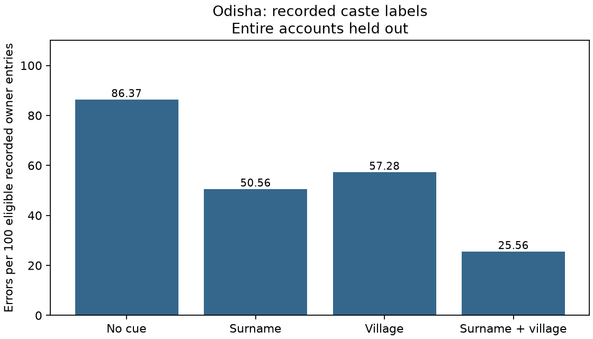

# Odisha land records: village premium

Snapshot: 2026-09-12T23:20:55.655306+00:00 to 2026-09-12T23:21:26.482006+00:00 (UTC).

Surname error: **50.56** per 100; surname plus village: **25.56**. Village premium: **25.00 percentage points**, removing 49.45% of surname error.

## What the records support

The question concerns people represented in land records. The measurable unit is a recorded owner entry after consolidating repeated account lists across plots. Entries are not verified unique people or households. Joint-owner multiplicity is retained; matching names across accounts are not automatically merged.

The target is the recorded caste field, with Unicode NFC and whitespace cleanup only. The final name token is the surname proxy. Rare labels and parenthetical text remain. Results describe aggregate predictability, not individual caste identity.

Each prediction excludes every eligible entry from its account. An empty cue cell falls back to the global mode after excluding that same account; a completely empty training set is unsupported. Ties follow lexical label order.

The crawl is unfinished and geography was not selected at random. This is a census of saved checkpoint prefixes, not a census of either state or its landholders. Missing caste/name fields and extraction failures may be selective. The direction of incomplete-coverage bias is unknown. Bihar remains contextual: target labels, observation units and scoring protocols differ.

## Census reconciliation

| Quantity | Count |
|---|---:|
| active incomplete streams | 254 |
| audited cells | 16,018,459 |
| audited record denominator | 5,569,849 |
| audited record numerator | 5,569,849 |
| audited successful records | 5,569,849 |
| caste fill rate | 0.971550540690734 |
| cells without owner entries | 10,394,908 |
| checkpoint files | 18,367 |
| confirmed complete units | 14,972 |
| confirmed complete villages | 14,972 |
| conflicting accounts | 0 |
| conflicting entries excluded | 0 |
| conflicting entries retained | 0 |
| consolidated owner entries | 12,522,593 |
| cross sheet conflicting accounts | 0 |
| districts with owner entries | 30 |
| dns failed attempts | 0 |
| dns unresolved keys | 0 |
| eligible entries | 12,155,300 |
| empty caste entries | 356,261 |
| empty name entries | 0 |
| excluded entries | 367,293 |
| expected units | 51,823 |
| failed attempts | 493,957 |
| failed attempts without identity | 0 |
| gzip tail or decode error | 254 |
| html successful records | 5,549,568 |
| http failed attempts | 47,113 |
| http unresolved keys | 571 |
| legacy completion status | 7 |
| name fill rate | 1.0 |
| other failed attempts | 418,166 |
| other unresolved keys | 18,986 |
| ownerless successful records | 680 |
| parsed owner entries before consolidation | 12,522,593 |
| parsed shard entries | 12,522,593 |
| pdf decoder failed attempts | 61 |
| pdf decoder unresolved keys | 0 |
| pdf provenance failed attempts | 120 |
| pdf provenance unresolved keys | 0 |
| pdf source failed attempts | 640 |
| pdf source unresolved keys | 332 |
| pdf successful records | 20,281 |
| portal miss attempts | 0 |
| repeated account entries removed | 0 |
| saved attempt rows | 6,063,806 |
| saved cells | 16,018,459 |
| successful attempts | 5,569,849 |
| timeout failed attempts | 27,857 |
| timeout unresolved keys | 1,511 |
| unique saved accounts | 5,569,849 |
| unique successful source keys | 5,569,849 |
| unresolved failed source keys | 21,400 |
| villages with owner entries | 18,365 |

Audited successful-record and cell counts above are numerators; saved successful attempts and saved cells are their denominators. Failed or invalid payloads remain explicit exclusions. Fill rates cover consolidated saved entries, not the population.

PDF cells reuse the source decoder’s all-page extraction. Original bytes, checksums, page-count metadata, printed account/village identity, and approved spelling evidence are retained and verified. This downstream run does not claim an independent OCR audit.

Failure counts describe attempts; unresolved-source-key counts remove keys with a saved successful answer or an explicit portal miss. These are distinct from ownerless successful captures. Failure categories reflect logged reasons.

## Sensitivities

| Analysis | Entries | Premium (points) |
|---|---:|---:|
| complete villages | 7,916,122 | 25.61 |
| signature sensitivity | 9,971,407 | 26.64 |
| normalization sensitivity | 12,108,119 | 25.42 |

The signature sensitivity collapses exact within-village matches of owner name, relative name, relation and residence when a relative is present. Conflicting caste labels are excluded from that sensitivity. Homonyms and absent relatives prevent interpreting it as verified person deduplication. Its holdout unit changes to that signature; it does not establish a bound on person-level error.

Odisha normalization, when present, is the former surname-assisted merge and label-floor method. It is exploratory because the target construction sees the full surname distribution; the recorded-label primary result does not use those merges.

## Surname proxy diagnostic

- entries with relative: 12,081,281
- entries sharing any token: 10,967,775
- entries sharing first token: 458,076
- entries sharing last token: 10,551,512

Token agreement is conditional on an available relative; first and last matches can overlap. It does not establish surname position for every owner.

## District results

| District code | Entries | Premium (points) |
|---|---:|---:|
| 1 | 1,070,558 | 15.12 |
| 10 | 682,990 | 8.17 |
| 11 | 537,065 | 11.57 |
| 12 | 79,056 | 2.48 |
| 13 | 878,856 | 10.13 |
| 14 | 324,540 | 8.75 |
| 15 | 269,159 | 8.97 |
| 16 | 425,247 | 11.56 |
| 17 | 415,263 | 13.51 |
| 18 | 538,821 | 14.49 |
| 19 | 299,575 | 10.18 |
| 2 | 336,682 | 9.47 |
| 20 | 345,138 | 12.94 |
| 21 | 104,834 | 2.95 |
| 22 | 120,606 | 12.07 |
| 23 | 67,521 | 6.99 |
| 24 | 419,082 | 14.11 |
| 25 | 107,044 | 3.34 |
| 26 | 193,569 | 4.74 |
| 27 | 689,250 | 4.02 |
| 28 | 155,273 | 14.62 |
| 29 | 67,202 | 6.50 |
| 3 | 1,077,327 | 17.77 |
| 30 | 198,335 | 2.90 |
| 4 | 316,200 | 12.53 |
| 5 | 767,688 | 24.60 |
| 6 | 346,077 | 10.53 |
| 7 | 568,051 | 13.73 |
| 8 | 311,180 | 8.83 |
| 9 | 443,111 | 10.76 |

District scores recompute the training population within each district. A pooled village cue also conveys district and region; pooled and district premiums answer different conditioning questions.

Run `2026-09-13T004033.565706Z`; manifest SHA-256 `20094905d9b9b88fb76d8e0afebf3b272ef7fcf2912878d1c8dd86dab874c255`.
