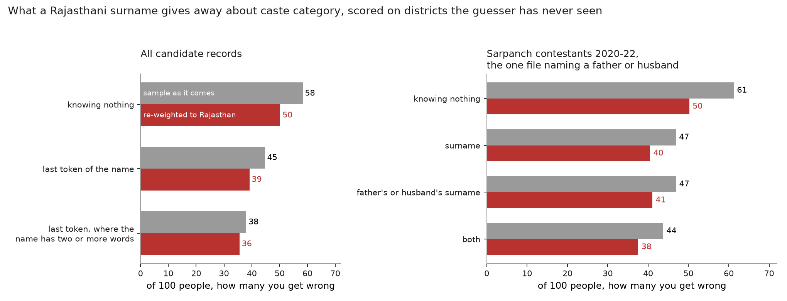
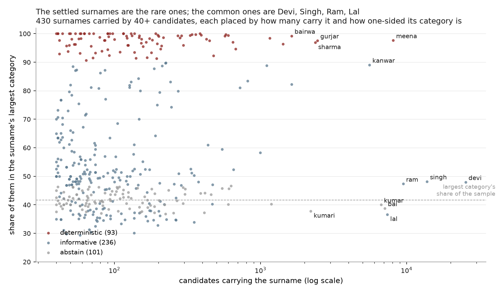

# What a surname reveals about caste category in Rajasthan

Every other analysis here that sorts people into census categories can tell a
Dalit or an Adivasi from everyone else, and nothing more, because SECC records
nothing finer. In Rajasthan "everyone else" is about seven people in ten, and
the line that matters inside it, between Other Backward Classes and General,
is one the census never drew. Panchayat elections draw it. Every candidate for
a village council seat declares a category to stand, and the State Election
Commission publishes it beside the name.

Pick a Rajasthani at random, know only the last word of their name, and guess
their category. Knowing nothing, you are wrong **50 times in
100**, because you guess OBC for everyone. With the name you are wrong
**39**. That closes 22%
of the gap, about what analysis 08 found for four categories in Karnataka,
and it is measured on districts the guesser has never seen.

## Scope, before the numbers

Three things about the source shape everything below.

**The category is self-declared.** It is what the candidate wrote on a
nomination form to stand for a seat, checked to the extent a returning officer
checks it. For a reserved seat a certificate is required; for a general seat
nothing is.

**The sample is shaped by reservation.** A seat reserved for Scheduled Tribes
takes only ST candidates, and Rajasthan reserves seats in proportion to local
population, so the tribal south sends whole slates of ST candidates. Among the
2020-22 sarpanch contestants ST is 26% of the file
against 13.5% of the state; across all 206,673 records it is
20%. The raw base rate is a fact about the quota, not about
Rajasthan. So every score is given twice: on the sample as it comes, and with
each record re-weighted so the four categories sit at the state's own shares.
Those shares are 17.8% SC and 13.5% ST from Census 2011, and the remaining
68.7% split OBC:General as 50:19, which is the ratio the state commission and
the Mandal-era estimates put it at. **No census records that split; it is an
assumption**, and moving it moves the re-weighted blind guess directly.

**A third of the names are one word.** 35% of
candidates are recorded as `SUNITA` or `KAMLA` or `BABULAL`, and for them the
"surname" a last-token rule reads is the given name. This is the same failure
analyses 04, 08 and 10 found in Maharashtra, Karnataka and Kerala, in a fourth
form: not the wrong token, not an initial, but a name that has only one token.

The records are 68,202 sarpanch contestants from
2020-22, 110,279 ward panch winners from the same
elections, and 28,192
sarpanch winners from 2005, 2010 and 2015, across 33 districts.
Only the first file names a father or husband. 18
records had no readable name and 13
had a category outside the four; both were dropped. 3%
of names are in Devanagari; the commonest Devanagari tokens are mapped to
their Latin spelling by hand, and 2%
of records keep a Devanagari token that forms its own cell.

## The headline, and what a relative's surname adds

| cue | sample as it comes | re-weighted to Rajasthan |
|---|---|---|
| knowing nothing | 58.3 | 50.2 |
| last token of the name | **44.7** | **39.2** |
| last token, names of two or more words | 38.0 | 35.6 |
| *2020-22 sarpanch contestants with a recorded relative's surname:* | | |
| knowing nothing | 61.2 | 50.2 |
| own surname | 46.9 | 40.5 |
| father's or husband's surname | 46.9 | 41.1 |
| both | **43.7** | **37.5** |

Mistakes per 100, from `out/tab/scores.csv`. Every figure is
leave-one-district-out: the table used to score a district is built from the
other 32. That is stricter than the leave-one-person-out the
other analyses use, and deliberately so, because a jati that lives in one
district would otherwise score itself. Leave-one-person-out gives
42.6 instead of 44.7, so about two
of the mistakes are geography the name carries and a stranger would not have.

Only the 2020-22 sarpanch contestant records also give a father's or husband's
name. Among the 68,195
candidates with a usable relative's surname, using the candidate's own surname
gives **40.5 incorrect caste-category guesses per 100
candidates**; using both surnames gives **37.5 mistakes
per 100**. Adding the relative's surname therefore saves about
**3 mistakes per 100 candidates**
when guessing SC, ST, OBC or General. Both figures use the same candidates,
category weights and held-out districts. The pooled surname error of
39.2 per 100 above uses the larger sample that also includes
election winners, so the gain from the extra surname is measured against the
40.5 baseline for contestants with a relative's surname.

Using only the father's or husband's surname gives
41.1 mistakes per 100 candidates, close to the
40.5 from the candidate's own surname. The pair cell resolves
56%
of contestants and the surname alone the rest. One might expect the gain to
come from women, whose own `Devi` says nothing and whose husband's `Meena`
says everything; it does not. Fitted and scored within each sex, the surname
leaves 47 for men and
47 for women, and both cues together
44 and 44.
A woman's recorded name is as often `Sunita Meena` as `Sunita Devi`.

Restricting to names with two or more words, where there is a surname to read,
takes the error from 39 to 36. The
difference is what the one-word names cost.

## It discriminates better than it decides

The ranking measure from analysis 01: take one person from the category and
one from outside it, rank the pair by what their surnames say, and count how
often the one in the category ranks higher. Half is no information.

| contrast | ranks the member higher |
|---|---|
| Scheduled Caste against the rest | **0.72** |
| Scheduled Tribe against the rest | **0.79** |
| OBC against General | **0.76** |

From `out/tab/ranking.csv`. The OBC/General line, which nothing in SECC can
draw, is drawn about as well by the surname as the SC line is. The national
SECC figures in analysis 01 are 0.80 for Dalit and 0.91 for Adivasi, on a
different population with a different last-token rule, so read the gap as a
direction and not a distance.

## Who the guess fails

| category | share of Rajasthan | wrong knowing nothing | wrong with the surname |
|---|---|---|---|
| OBC | 50% | 0 | **12** |
| General | 19% | 100 | **51** |
| ST | 14% | 100 | **66** |
| SC | 18% | 100 | **83** |

Re-weighted, from `out/tab/by_category.csv`. The blind guess says OBC, so it is
right about every OBC and wrong about everyone else; the surname fixes most of
the ST errors and few of the SC ones. Analysis 05 found the same direction
nationally and analysis 08 in Karnataka: the guess is wrong most often about
the people the categories exist for. Here it is wrong about
83
of every 100 Dalits.

## Which surnames settle it

430 tokens are carried by 40 or more candidates, covering
74% of records. Each is placed by how one-sided
its category is:

- **deterministic**, at least 90% one category: 93
  tokens, 15% of records;
- **informative**, the rest that move the guess: 236
  tokens, 44%;
- **abstain**, a majority within five points of that category's base rate:
  101 tokens, 15%.

The settled names are mostly the name of the caste itself. Of the
93 deterministic tokens, **63
are literally a jati name** (68%)
by a hand list in `pipeline.py`, and 23 more are
the clan of one: Shekhawat and Ranawat among Rajputs, Godara among Jats, Katara
and Ninama among Bhils. The commonest are `meena` (ST, 98%), `gurjar` (OBC, 98%), `sharma` (General, 97%), `bairwa` (SC, 99%), `jat` (OBC, 96%), `saini` (OBC, 98%), `kumawat` (OBC, 97%), `bhil` (ST, 99%). That leaves
7: `choudhary`, `verma`, `gupta`, `giri`, `chaudhary`, `mehar`, `tailor`. A surname in Rajasthan pins the
category when it *is* the category, and Yadav, Meena and Bairwa are not a
signal that has to be learned; they are the answer written on the form.

Two of the leftovers are findings. **`verma` is 92%
Scheduled Caste** here, on 476 candidates, a surname several
communities carry elsewhere in north India and one Dalit communities have
taken in Rajasthan. **`kanwar` is 89% General**
on 5,569, because it is what Rajput women are called, the female
counterpart of `singh`; a sex-marking name that carries caste, which `devi`
does not. And `kaur`, 997 Sikh women, splits
58% OBC to 31% SC.

The abstain tier is almost entirely given names. After `bai`, `kumar`,
`kumari` and `chand` it reads `sunita`, `kamla`, `prakash`, `prasad`, `anita`, `mamta`, `rekha`, `geeta`: people recorded by one name,
whose last token is their first.

## Where the ambiguous mass is

| token | n | share of records | SC | ST | OBC | General | tier |
|---|---|---|---|---|---|---|---|
| `devi` | 25,337 | 12% | 24% | 15% | 48% | 13% | informative |
| `singh` | 13,808 | 7% | 10% | 3% | 39% | 48% | informative |
| `ram` | 9,469 | 5% | 31% | 14% | 47% | 7% | informative |
| `meena` | 8,089 | 4% | 1% | 98% | 1% | 1% | deterministic |
| `lal` | 7,373 | 4% | 25% | 30% | 37% | 9% | informative |
| `bai` | 7,105 | 3% | 20% | 33% | 39% | 9% | abstain |
| `kumar` | 6,681 | 3% | 32% | 13% | 40% | 15% | abstain |
| `kanwar` | 5,569 | 3% | 0% | 0% | 10% | 89% | informative |
| `gurjar` | 2,450 | 1% | 0% | 0% | 98% | 2% | deterministic |
| `sharma` | 2,371 | 1% | 0% | 0% | 3% | 97% | deterministic |
| `kumari` | 2,207 | 1% | 32% | 18% | 38% | 12% | abstain |
| `bairwa` | 1,633 | 1% | 99% | 0% | 0% | 0% | deterministic |
| `khan` | 1,630 | 1% | 0% | 0% | 82% | 18% | informative |
| `jat` | 1,422 | 1% | 0% | 0% | 96% | 3% | deterministic |
| `chand` | 1,184 | 1% | 29% | 17% | 40% | 14% | abstain |
| `saini` | 1,159 | 1% | 0% | 0% | 98% | 1% | deterministic |
| `yadav` | 1,099 | 1% | 7% | 0% | 89% | 4% | informative |
| `kaur` | 997 | 0% | 31% | 0% | 58% | 11% | informative |
| `kunwar` | 815 | 0% | 0% | 0% | 16% | 83% | informative |
| `bano` | 723 | 0% | 0% | 0% | 81% | 19% | informative |

From `out/tab/commonest_tokens.csv`. The first three names cover a quarter of
the records and none of them settles anything. `devi` is every category at
roughly the state's rate. `singh` is half General and two fifths OBC, so it
moves the guess and remains wrong about half its bearers. `ram` and `lal` are
the Dalit end of the same problem, a third SC each, still short of a majority.
Analysis 01's finding that the commonest names tell you least holds here with
four categories as it did with three.

## Against SECC

outkast's Rajasthan extract holds 242 surnames that cleared a
100-record floor, and 150 of them are among the election
tokens above. For those, the election data's SC share correlates with SECC's
at **0.978** and its ST share at
**0.995** (re-weighted; 0.977 and
0.994 raw). Two sources, one a census of heads of household
and the other a list of people who stood for office a decade later, agree on
what a name means. SECC cannot see OBC against General, so the comparison stops
there.

The disagreements are small cells and point one way:

| token | election n | SECC n | SC share, election | SC share, SECC |
|---|---|---|---|---|
| `suman` | 545 | 6,487 | 24% | 0% |
| `solanki` | 58 | 1,648 | 28% | 5% |
| `bhati` | 79 | 1,402 | 29% | 7% |
| `garg` | 59 | 1,155 | 56% | 27% |
| `tanwar` | 51 | 1,038 | 31% | 3% |
| `panwar` | 63 | 230 | 54% | 14% |
| `bharti` | 65 | 101 | 31% | 2% |

From `out/tab/outkast_compare.csv`. `suman` is a woman's given name in the
election file and a surname in SECC, so it is not the same token. Solanki,
Bhati, Tanwar and Panwar are Rajput clan names that Dalit communities in
Rajasthan also carry, and a file of candidates for reserved seats holds more
of the latter than a census does. `garg` and `bharti` are cells of sixty.

## How the numbers are computed

The surname is the last token of the candidate's own name after cutting at a
slash or `S/O` and dropping single letters. The guess for a token is its
commonest category among candidates in *other* districts; a token no other
district has seen falls back to the blind guess. Re-weighting multiplies each
record by the ratio of its category's assumed state share to its sample share,
and both the table and the score use the weights. `both` uses the
(surname, father's surname) pair where another district has seen it, else the
surname. The token tiers are in-sample and unweighted, being a description of
the tokens rather than a score.

---

*Sarpanch and ward panch records from the Rajasthan State Election Commission,
collected in
[local_elections_rajasthan](https://github.com/in-rolls/local_elections_rajasthan).*
